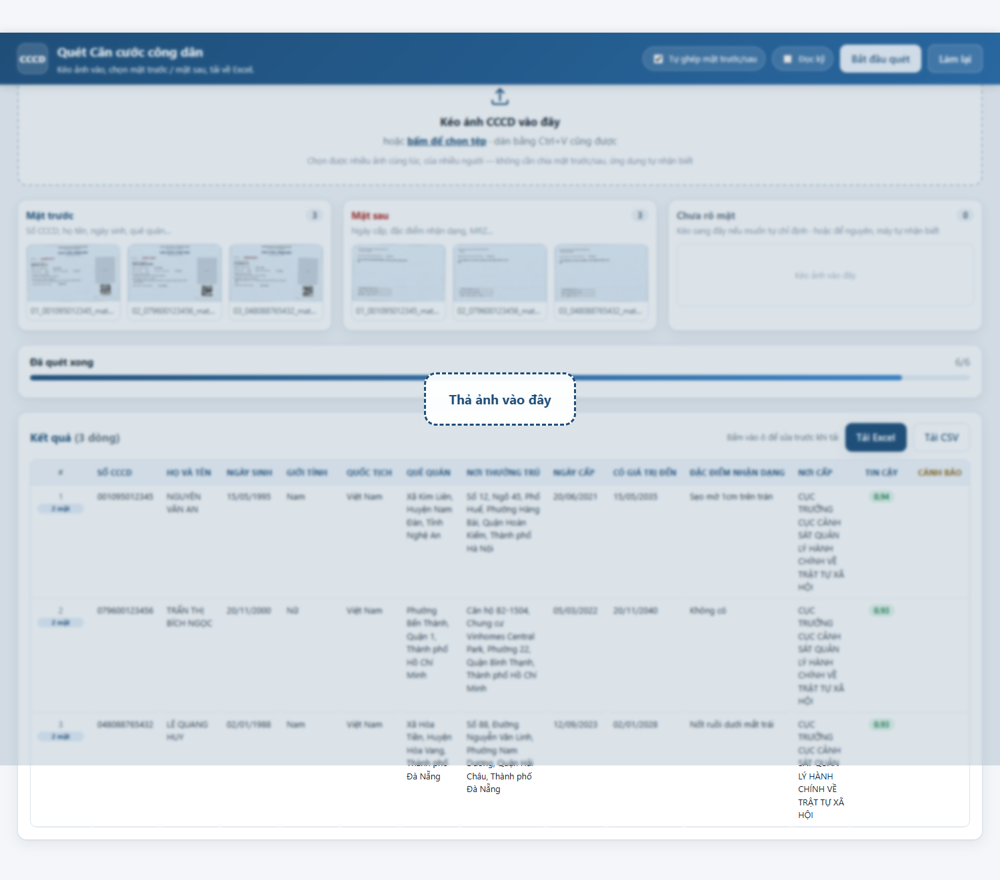

# CCCD OCR — quét ảnh Căn cước công dân ra Excel

[](https://github.com/callmedinh/cccd-ocr/actions/workflows/ci.yml)
[](https://www.python.org/)
[](LICENSE)
[](#6-gi%E1%BB%9Bi-h%E1%BA%A1n)

Kéo ảnh Căn cước công dân vào → chọn đâu là mặt trước, đâu là mặt sau → tải về
file Excel. Chạy **hoàn toàn offline** trên máy bạn, ảnh thẻ công dân không được
gửi lên bất kỳ máy chủ nào.



Trích xuất được: số CCCD · họ tên · ngày sinh · giới tính · quốc tịch · quê quán ·
nơi thường trú · ngày cấp · ngày hết hạn · đặc điểm nhận dạng · nơi cấp.

---

## 1. Cài đặt

### Bước 1 — Tesseract 5 (bộ đọc chữ)

```powershell
winget install UB-Mannheim.TesseractOCR     # Windows
```

```bash
brew install tesseract                       # macOS
sudo apt install tesseract-ocr               # Ubuntu/Debian
```

### Bước 2 — thư viện Python

```powershell
pip install -r requirements.txt
```

### Bước 3 — bộ dữ liệu tiếng Việt

```powershell
python tools/get_models.py
```

Tải `vie.traineddata` (~12 MB) vào `models/tessdata/`. Dự án tự trỏ Tesseract vào
thư mục này nên **không cần quyền Administrator**.

---

## 2. Cách dùng — giao diện kéo-thả (khuyến nghị)

```powershell
python gui.py
```

Trình duyệt tự mở tại `http://127.0.0.1:8765`.

1. **Kéo nhiều ảnh một lúc** vào khung, hoặc bấm *chọn tệp*, hoặc dán bằng `Ctrl+V`.
2. Ảnh rơi vào cột **Chưa rõ mặt**. Kéo từng ảnh sang **Mặt trước** hoặc
   **Mặt sau** — hoặc thả thẳng ảnh vào đúng cột ngay từ đầu.
3. Bấm **Bắt đầu quét** (hoặc `Ctrl+Enter`).
4. Bảng kết quả hiện ra: **bấm vào ô nào cũng sửa được** trước khi tải.
5. Bấm **Tải Excel** hoặc **Tải CSV**.

Những điểm đáng chú ý:

- Thả ảnh vào đúng cột là đủ để ghép cặp — không cần đặt tên tệp. Cặp được ghép
  theo số CCCD; nếu ảnh mờ không đọc được số thì ghép theo thứ tự (mặt trước thứ
  *i* ↔ mặt sau thứ *i*).
- Ô **Tự ghép mặt trước/sau**: bật (mặc định) thì mỗi công dân là một dòng, gộp cả
  hai mặt; tắt thì mỗi ảnh thành một dòng riêng.
- Ảnh ở cột *Chưa rõ mặt* vẫn được máy tự đoán mặt trước / mặt sau khi quét.
- Ô **Đọc kỹ**: đọc thêm biến thể ảnh, chậm hơn nhưng tốt hơn với thẻ mờ/nghiêng.
- **Refresh trang không mất dữ liệu** — phiên làm việc được khôi phục.
- Rê chuột vào ảnh: `×` để bỏ ảnh, `⤢` để mở ảnh gốc trong tab mới.
- Cột **#** hiện huy hiệu `2 mặt` cho những dòng đã gộp cả hai mặt; rê chuột vào
  dòng để xem tên hai tệp nguồn.
- Toàn bộ máy chủ chỉ lắng nghe `127.0.0.1`. Đổi cổng: `python gui.py --port 9000`.

---

## 3. Cách dùng — dòng lệnh

```powershell
# Cả thư mục (quét đệ quy, tự ghép mặt trước + mặt sau)
python main.py anh_cccd/ -o ket_qua.xlsx --csv

# Vài ảnh cụ thể
python main.py mat_truoc.jpg mat_sau.jpg -o ket_qua.xlsx

# Thẻ khó đọc (mờ, nghiêng, lóa): đọc kỹ hơn, chậm hơn ~3 lần
python main.py anh/ --thorough

# Nhanh: 1 lượt đọc, ~1 giây/ảnh
python main.py anh/ --fast

# Ghi nối vào file Excel đã có
python main.py anh_moi/ -o ket_qua.xlsx --append
```

Ảnh đầu vào: `jpg`, `png`, `bmp`, `webp`, `tif`.

| Tuỳ chọn | Ý nghĩa |
| --- | --- |
| `-o, --output` | File Excel đầu ra (mặc định `output/cccd.xlsx`) |
| `--csv` | Xuất thêm `.csv` cùng tên — dùng cho Google Sheets |
| `--thorough` | Đọc thêm biến thể ảnh và chế độ psm 6 |
| `--fast` | Chỉ 1 lượt đọc (nhanh ~4×) |
| `--append` | Nối vào file Excel đã có |
| `--backend rapidocr` | Dùng PP-OCRv5 khi không cài được Tesseract |
| `--lang` | Ngôn ngữ Tesseract (mặc định `vie`) |
| `--json PATH` | Xuất JSON chi tiết để kiểm tra |
| `-q, --quiet` | Không in tiến độ |

---

## 4. Kết quả

File Excel có 15 cột, đóng băng dòng tiêu đề, bật bộ lọc:

| Cột | Ghi chú |
| --- | --- |
| STT | Số thứ tự |
| Số CCCD | 12 chữ số, giữ nguyên số 0 ở đầu (định dạng Text) |
| Họ và tên | Giữ dấu tiếng Việt như in trên thẻ |
| Ngày sinh / Ngày cấp / Có giá trị đến | `dd/mm/yyyy` |
| Giới tính | `Nam` / `Nữ` |
| Quốc tịch | Thường là `Việt Nam` |
| Quê quán / Nơi thường trú | Ghép cả đoạn địa chỉ bị xuống dòng |
| Đặc điểm nhận dạng / Nơi cấp | Đọc từ mặt sau |
| **Độ tin cậy** | 0–1; dưới ~0,75 nên xem lại ảnh |
| **Cảnh báo** | Lý do cần kiểm tra (ô được tô vàng) |
| Tệp nguồn | Ảnh mặt trước / mặt sau đã dùng |

### Đưa sang Google Sheets

Chạy `--csv` (hoặc bấm *Tải CSV* trong giao diện) rồi:

1. Google Sheets → **File → Import → Upload** → chọn `ket_qua.csv`
2. Kiểu phân tách: **Comma**, mã hoá **UTF-8**

File CSV có BOM UTF-8 nên tiếng Việt không bị lỗi font. Muốn đẩy thẳng lên một
Sheet có sẵn thì dùng `gspread` với service account — `CardRecord.to_row()` đã
trả về đúng dict theo cột.

---

## 5. Cách hoạt động

### Tiền xử lý (`preprocess.py`)

Ảnh được phóng lên ~2400 px chiều rộng (dấu tiếng Việt rất nhỏ, phóng to giúp
Tesseract đọc đúng dấu), tìm viền thẻ để nắn phối cảnh nếu ảnh bị chụp nghiêng,
rồi tạo 2 biến thể: ảnh xám tăng tương phản cục bộ (CLAHE) và ảnh giữ màu. Mỗi
biến thể được đọc riêng, sau đó **bỏ phiếu ở mức trường** — biến thể nào đọc được
nhiều trường và tự tin hơn thì thắng, biến thể khác chỉ bù chỗ trống.

### Bóc tách theo nhãn (`parser.py`)

Bám vào nhãn in trên thẻ. Nhãn được so khớp **sau khi bỏ dấu**, nên `Họ và tên`,
`HO VA TEN`, `Ho va ten / Full name` đều khớp cùng một mẫu. Giá trị lấy từ phần
còn lại của dòng, hoặc từ các dòng bên dưới nếu bị tách rời (địa chỉ trên thẻ
thật thường xuống 2–3 dòng).

Hai cái bẫy đã xử lý riêng:

- `Giới tính: Nam   Quốc tịch: Việt Nam` in chung một dòng → cắt đúng tại nhãn kế tiếp.
- Địa chỉ `Số 12, Ngõ 45...` bắt đầu bằng chữ "Số" → không bị nhầm thành nhãn
  "Số / No." rồi cắt cụt địa chỉ.

### MRZ mặt sau (`mrz.py`)

CCCD gắn chip có 3 dòng MRZ ở đáy mặt sau. Dải này được đọc riêng với danh sách
ký tự giới hạn (`A–Z 0–9 <`), chế độ một khối — chính xác hơn hẳn cách đọc cả
trang. Sau đó:

- Sửa các nhầm lẫn quen thuộc của OCR: `Q/O/D→0`, `I/L→1`, `S→5`, `B→8`.
- Kiểm tra **check digit ICAO 9303** cho ngày sinh và ngày hết hạn.
- Bỏ dòng họ tên nếu nó chứa chữ số (dấu hiệu nhận nhầm dòng).
- Bỏ ngày vô lý (ví dụ hạn dùng rơi vào năm 1946) thay vì ghi giá trị rác.

### Đối chiếu chéo (`idcheck.py`)

Số CCCD 12 chữ số có cấu trúc cố định:

```
001 0 95 012345
 │   │ │  └── số ngẫu nhiên
 │   │ └──── 2 số cuối năm sinh
 │   └────── mã thế kỷ + giới tính (0,1=nam XX · 2,3=nữ XX · 4,5=nam XXI · 6,7=nữ XXI)
 └────────── mã tỉnh/thành
```

Nhờ vậy công cụ kiểm tra được số CCCD có khớp với ngày sinh và giới tính đọc
được hay không — và dùng chính phép kiểm tra đó để **phân xử** khi số in trên thẻ
mâu thuẫn với số trong MRZ (`aggregate.py`).

### Ghép mặt trước + mặt sau (`models.py`)

Hai ảnh của cùng một người được gộp thành một dòng. Khi hai mặt đọc ra giá trị
khác nhau, ưu tiên **mặt sở hữu trường đó**: họ tên / ngày sinh / quê quán in ở
mặt trước, ngày cấp / đặc điểm nhận dạng / nơi cấp in ở mặt sau. Mọi mâu thuẫn
đều được ghi vào cột *Cảnh báo* chứ không âm thầm chọn một bên.

### Giao diện (`gui/`)

Máy chủ HTTP bằng `http.server` của thư viện chuẩn, phục vụ một trang HTML/JS
thuần (không framework, không CDN). Ảnh được gửi lên dưới dạng base64, OCR chạy
trong luồng nền, trình duyệt hỏi tiến độ mỗi 0,7 giây.

---

## 6. Giới hạn — đọc trước khi dùng cho việc quan trọng

- **Không có gì được tự động “đoán” cho đẹp.** Trường không đọc được thì để trống
  và ghi cảnh báo; không có giá trị nào được bịa ra.
- **Dấu thanh phức hợp là điểm yếu.** `Ễ Ẫ Ỡ Ỹ` (dấu mũ + dấu thanh chồng nhau)
  đôi khi bị đọc thành `Ê Ấ Ớ Ý`. Ảnh càng nét, glyph càng lớn thì càng đúng —
  nên chụp ở độ phân giải cao, ánh sáng đều, không lóa.
- **Nên kiểm tra tay mọi dòng có cảnh báo**, đặc biệt cột *Độ tin cậy* dưới 0,75.
  Đây là công cụ hỗ trợ nhập liệu, không phải nguồn dữ liệu pháp lý.
- **Thẻ cũ / CMND 9 số** vẫn đọc được nhưng cấu trúc khác nên phần đối chiếu
  cấu trúc sẽ cảnh báo.
- Máy chủ GUI chỉ nên nghe `127.0.0.1`. Đừng mở ra mạng LAN (`--host 0.0.0.0`)
  khi chưa có xác thực — ai vào được cũng tải được ảnh thẻ đang có trong phiên.

## 7. Vì sao dùng Tesseract mà không dùng PaddleOCR?

Đã thử cả hai. Bộ nhận dạng `latin` của PP-OCRv5 có **từ điển thuần ASCII** — nó
không thể sinh ra `ộ ệ ữ ỹ`, nên họ tên và địa chỉ mất sạch dấu
(`NGUYỄN` → `NGUYEN`). Tesseract với `vie.traineddata` đọc đúng dấu tiếng Việt.

RapidOCR/PP-OCRv5 vẫn được giữ làm backend dự phòng (`--backend rapidocr`) cho máy
không cài được Tesseract: số CCCD, ngày tháng và MRZ vẫn đọc tốt vì không có dấu,
chỉ họ tên và địa chỉ là mất dấu.

---

## 8. Kiểm thử

```powershell
python -m unittest discover -s tests -v
```

57 bài kiểm thử: giải mã MRZ và check digit, chuẩn hoá ngày/giới tính, cấu trúc số
CCCD, bóc tách theo nhãn (không cần OCR), ghi Excel/CSV, ghép cặp mặt trước–sau
(kể cả trường hợp mặt sau mờ không đọc ra số), và một bài tích hợp dựng máy chủ GUI
thật rồi upload → quét → xuất file.

```powershell
python tools/debug_one.py samples/01_001095012345_mat_truoc.jpg   # xem OCR thô
python tools/make_samples.py                                     # sinh ảnh mẫu
```

---

## 9. Cấu trúc mã nguồn

```
gui.py                          mở giao diện kéo-thả trong trình duyệt
main.py                         điểm vào dòng lệnh
cccd_ocr/
  cli.py                        tham số dòng lệnh, quét thư mục, ghép bản ghi
  ocr_engine.py                 chọn backend, OCR nhiều biến thể ảnh
  backends/tesseract_backend.py gọi Tesseract, đọc TSV, đọc riêng vùng MRZ
  ocr_rapid.py                  backend dự phòng PP-OCRv5 (ONNX)
  preprocess.py                 phóng to, nắn phối cảnh, CLAHE
  parser.py                     ghép dòng + bóc tách theo nhãn
  mrz.py                        giải mã TD1, check digit ICAO 9303
  idcheck.py                    cấu trúc số CCCD, đối chiếu ngày sinh / giới tính
  aggregate.py                  bỏ phiếu giữa biến thể, phân xử số CCCD
  models.py                     CardRecord, TextItem, gộp mặt trước/sau
  textnorm.py                   bỏ dấu, chuẩn hoá ngày, sửa lỗi OCR số
  excel_writer.py               ghi .xlsx / .csv
  console.py                    ép console Windows in được tiếng Việt
  gui/                          máy chủ HTTP + trang kéo-thả (HTML/CSS/JS thuần)
tools/                          debug_one.py, make_samples.py, get_models.py
tests/                          test_cccd.py, test_gui.py (57 bài)
models/tessdata/                vie.traineddata + configs của Tesseract
samples/                        ảnh mẫu — toàn bộ dữ liệu hư cấu
```

---

## 10. Quyền riêng tư

- Không có mã nào gọi ra internet, trừ `tools/get_models.py` (tải bộ dữ liệu
  Tesseract một lần) và lần đầu chạy RapidOCR (tải model về máy).
- Ảnh chỉ nằm trong thư mục tạm của hệ điều hành và **bị xoá khi bạn đóng cửa sổ
  chạy `gui.py`**.
- Dữ liệu CCCD là dữ liệu cá nhân nhạy cảm theo Nghị định 13/2023/NĐ-CP. Hãy chắc
  chắn bạn có cơ sở pháp lý để xử lý trước khi dùng cho số lượng lớn.

## Giấy phép

[MIT](LICENSE)
